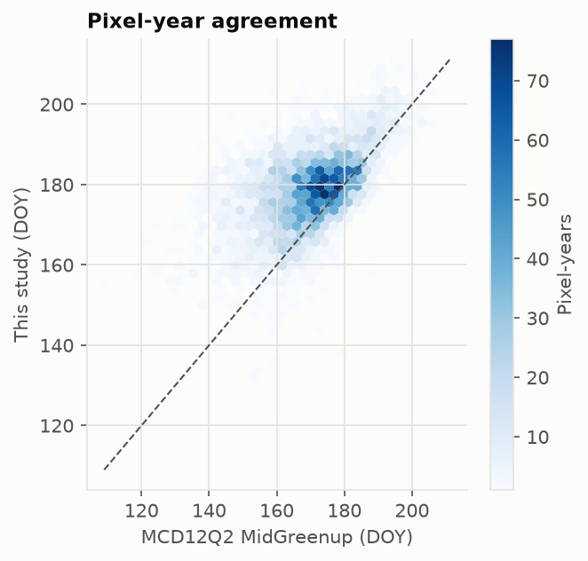

## Abstract

This study sought to determine whether the timing of spring green-up in Wapusk National Park (Manitoba, Canada) shifted between 2001 and 2024, and how much of its year-to-year variation is explained by snowmelt timing and spring temperature.
Mid-green-up, defined as the day on which smoothed MODIS NDVI reaches half of its seasonal amplitude above a snow-free dormant baseline, was estimated for 300 land pixels stratified by land cover and aggregated to an area-weighted park-wide value for each year.
The analysis was pre-registered before any trend or driver relationship in the response was examined.
Park-wide mid-green-up averaged day of year (DOY) 180 (SD 7.5 days) and showed no detectable trend, with a Theil–Sen slope of +0.03 days/yr (95% CI −0.33 to +0.47); the interval excludes advances faster than about a third of a day per year, but a pre-registered power analysis indicates that trends below roughly 0.9 days/yr would often go undetected, so the result rules out large shifts rather than demonstrating stability.
In contrast, snowmelt timing and spring warmth explained most of the interannual variation: later ERA5-Land snow-off was associated with later green-up (5.4 days per standard deviation, R² = 0.52), and April–May thawing degree days at Churchill explained a further 25% of the variance (95% CI 9–48%), for a combined R² of 0.77 and a leave-one-year-out error of 4.1 days.
All three findings held across 24 alternative processing specifications, and the park-wide series tracked the independent MCD12Q2 product closely (r = 0.90).
A sandboxed agent-driven search for a better green-up extractor was also run on synthetic data, kept entirely separate from the confirmatory analysis, and is reported in an appendix.

## Introduction

Wapusk National Park lies on the western coast of Hudson Bay, in the transition between boreal forest and Arctic tundra, and its vegetation supports polar bears that forage on land during the ice-free season, as well as caribou and nesting geese whose breeding success depends on the timing of high-quality forage.
Doiron et al. [-@doiron2013] demonstrated on Bylot Island that the date on which NDVI reaches half of its annual maximum predicts the peak in plant nitrogen concentration, and Mallory et al. [-@mallory2020] reported that green-up on the Qamanirjuaq caribou calving grounds, west of Hudson Bay, advanced by 7.25 days between 2004 and 2016, with migration and calving advancing alongside it.
Whether green-up has in fact advanced in Wapusk, however, has not been established, and an earlier exploratory notebook in this repository fitted linear trends to a raw half-maximum NDVI date and produced slopes that changed sign between runs of identical code.

This report therefore replaces that exploration with a pre-registered analysis built around two questions.
First, it estimates the trend in mid-green-up between 2001 and 2024, together with the smallest trend the record could detect.
Next, it tests whether snow-off timing explains interannual variation in mid-green-up, and whether spring thawing degree days explain variation beyond snow-off.
The report then examines the sensitivity of each answer to 24 processing choices, compares the result with the MODIS Land Cover Dynamics product, and closes with the limitations of the design.

## Study Area

Wapusk National Park covers 11,475 km² of coastal lowland south and east of Churchill, Manitoba (57.1–58.8° N, 92.3–93.9° W).
The boundary used here is the Canada Lands Survey System administrative polygon published by Natural Resources Canada under the Open Government Licence (Canada).
Peatland and fen dominate the landscape, with shrub and graminoid tundra near the coast, lichen-dominated heath on raised beach ridges, and open spruce forest in the south and west.
Among randomly drawn 500 m pixels with little open water, ESA WorldCover classifies 57% as herbaceous wetland, 33% as shrub or grassland, 7% as moss and lichen, and 2% as tree cover (@fig-study-area).

{#fig-study-area width=55%}

## Data

All satellite and reanalysis inputs were accessed through Google Earth Engine [@gorelick2017].
Daily surface reflectance came from MOD09GA collection 6.1 [@vermote2021mod09ga], from which NDVI was computed from bands 1 and 2; MCD43A4 collection 6.1 nadir BRDF-adjusted reflectance [@schaaf2021mcd43a4] provided an alternative NDVI series.
Snow cover came from MOD10A1 collection 6.1 [@hall2021mod10a1] and from ERA5-Land daily aggregates [@munozsabater2021], which also supplied 2 m air temperature, snow depth, and precipitation.
The MCD12Q2 collection 6.1 Land Cover Dynamics product [@friedl2022mcd12q2] served only as an independent validation reference.
Surface water came from the JRC Global Surface Water occurrence layer [@pekel2016], and land cover from ESA WorldCover 10 m v200 [@zanaga2022].
Daily mean temperature, precipitation, and snow on the ground at Churchill came from Environment and Climate Change Canada climate stations 5060600 (2001–2005) and 5060608 (2006–2024), with station 5060595 filling gaps.

## Methods

### Pixel Sample

Per-pixel phenology was estimated on a fixed sample rather than on a park-wide mean, because a mean over whichever pixels happen to be cloud-free on a given day mixes landscapes with different phenology from one day to the next.
Candidate pixel centres were drawn at random (seed 20261014) from the 53,164 MODIS 500 m grid cells inside the boundary, and the water fraction and modal WorldCover class of each candidate's exact footprint were computed at native resolution.
Pixels with more than 10% JRC surface water (occurrence above 50%) were excluded, which removed 28% of candidates, and the first 75 remaining candidates in each of four strata (forest, shrub and grassland, wetland, moss and lichen) were retained.
The sample is committed as `data/aoi/sample_points.geojson`, so every run uses identical pixels.

### NDVI and Quality Masking

Two quality masks were applied to MOD09GA.
The strict (primary) mask retained a pixel only where the `state_1km` cloud state was clear or unset, no cloud shadow, internal cloud, MOD35 snow, internal snow, or cloud-adjacency flag was set, cirrus was absent or small, the sensor zenith angle was below 45°, and the `QC_500m` MODLAND flag indicated ideal or less-than-ideal quality.
The lenient mask kept only the cloud-state, internal cloud, internal snow, and MODLAND conditions.
The snow flags were also retained as a separate band, so that snow-covered days could anchor the dormant baseline rather than simply disappear.
Under the strict mask, 11% of pixel-days between DOY 60 and 320 were usable, compared with 17% under the lenient mask.

### Green-Up Extraction

For each pixel, a dormant baseline was defined as the 5th percentile of all snow-free NDVI observations outside DOY 150–250, pooled across years [@beck2006].
Within the DOY 91–300 window of each pixel-year, observed NDVI below the baseline was raised to it, and snow-flagged days before the first and after the last snow-free observation were entered as baseline values.
The primary smoother interpolated these points to a daily series and applied a Savitzky–Golay filter (31-day window, second-order polynomial) with two upper-envelope passes, in which observations falling below the fitted curve were treated as residual cloud contamination [@chen2004].
Mid-green-up was the first day before the seasonal peak on which the curve reached the baseline plus 50% of the amplitude, interpolated linearly between days.
Pixel-years with fewer than 15 snow-free observations, an amplitude below 0.10 NDVI, or a crossing at the window start were treated as missing.
@fig-example-fits shows three randomly drawn pixel-years.

This definition departs from Doiron et al. [-@doiron2013], who used 50% of the annual maximum rather than of the amplitude above a baseline.
The amplitude form was preferred because it does not depend on the NDVI of snow, which is negative and highly variable, and because it corresponds directly to the MCD12Q2 `MidGreenup` metric used for validation.

{#fig-example-fits}

Park-wide mid-green-up for each year was the weighted median across valid pixels, where each pixel's weight was its stratum's share of dry land divided by the number of valid pixels in that stratum that year; this corrects for the equal allocation of the sample across strata.
Between 227 and 300 of the 300 pixels contributed in each year.

### Predictors

The pre-registered snow-off date was the day after the last day between DOY 60 and 212 on which park-mean ERA5-Land snow cover was at or above 50%.
ERA5-Land was chosen over the Churchill station before any relationship with green-up was examined, for three reasons: the station lacked a usable spring snow-on-ground record in 9 of 24 years; where present, station snow-off correlated with park-wide estimates at only r = 0.58; and ERA5-Land and MODIS snow-off agreed at r = 0.81 despite their independent sources.
Neither primary predictor relies on the MODIS snow flags that shape the NDVI series, which avoids building a mechanical correlation between snow-off and green-up.
Thawing degree days (TDD) were the sum of positive daily mean temperatures at Churchill between 1 April and 31 May, a window chosen to end before the earliest plausible mid-green-up; 14 of 1,464 station-days were filled from ERA5-Land through a daily linear calibration.

### Statistical Analysis

The trend in mid-green-up (H1) was estimated as a Theil–Sen slope [@sen1968] with a 95% confidence interval, accompanied by Mann–Kendall tests with and without trend-free pre-whitening [@yue2002].
Because a trend estimate from 24 years is only informative relative to the smallest trend the series could reveal, the minimum detectable trend was simulated before the response was examined, using the detrended interannual standard deviation of the independent MCD12Q2 series (9.2 days) and an AR(1) noise model; Mann–Kendall reached 80% power at α = 0.05 only for trends of 0.9 days/yr or larger.

The association with snow-off (H2) was tested with ordinary least squares on standardized predictors, and the added contribution of TDD (H3) with a nested F-test and a bootstrap confidence interval (5,000 resamples of years) for the change in R².
Because warmer springs also melt snow earlier, the explained variance was further partitioned into unique and shared components by commonality analysis [@seibold1979], and both models were evaluated by leave-one-year-out cross-validation.

### Robustness Grid and Validation

H1 to H3 were re-estimated across 24 specifications formed by three smoothers (Savitzky–Golay; a double logistic with fixed baseline after @beck2006; a weighted Whittaker smoother after @eilers2003), two thresholds (50% and 15% of amplitude), two masks (strict and lenient), and two aggregations (weighted median and weighted mean).
Alternative predictor sources (station snow-off gap-filled from ERA5-Land, and ERA5-Land TDD), an NBAR-based NDVI series, and per-stratum trends were evaluated as further sensitivity checks.
Agreement with MCD12Q2 `MidGreenup_1`, restricted to best- and good-quality retrievals, was computed at both the pixel-year and the annual scale.

## Results

### Validation Against MCD12Q2

The primary series tracked MCD12Q2 closely at the annual scale (r = 0.90), although estimates were on average 8.6 days later at the pixel-year scale (MAE 10.1 days, r = 0.55, n = 5,126).
The NBAR series gave nearly identical agreement (annual r = 0.91, pixel-year r = 0.63).
The offset is consistent with the strict mask, which discards early-season observations near cloud and snow, and with MCD12Q2's use of EVI2 with its own baseline; since both trend and driver analyses depend on interannual variation rather than absolute dates, a constant offset does not bias them.

{#fig-validation width=55%}

### Trend (H1)

Park-wide mid-green-up ranged from DOY 165 in 2006 to DOY 196 in 2009 (mean 180, SD 7.5 days) and showed no trend: the Theil–Sen slope was +0.03 days/yr (95% CI −0.33 to +0.47), with Mann–Kendall p = 0.86 and trend-free pre-whitened p = 0.60 (@fig-series).
The confidence interval excludes advances faster than about a third of a day per year; it is narrower than the pre-registered power analysis anticipated because the primary series varies less from year to year than MCD12Q2 (SD 7.5 against 9.2 days), which made that analysis conservative.
Following the pre-registered interpretation rule, the result is reported as no trend detectable at this sensitivity rather than as evidence that green-up has not changed.
The independent MCD12Q2 series (+0.10 days/yr, CI −0.40 to +0.67) and the NBAR series (−0.04 days/yr, CI −0.40 to +0.43) agreed, as did each land-cover stratum, whose slopes ranged from +0.01 (wetland) to +0.17 days/yr (forest) with every interval spanning zero.

{#fig-series}

### Snow-Off and Spring Warmth (H2 and H3)

Snow-off explained roughly half of the interannual variation in mid-green-up (@fig-drivers): each standard deviation (15 days) of later snow-off corresponded to 5.4 days later green-up (95% CI 3.1–7.7, p < 0.001, R² = 0.52), or about 0.35 days per day of snow-off.
Adding TDD increased R² by 0.25 (bootstrap 95% CI 0.09–0.48; F = 22.3, p < 0.001), and in the combined model each standard deviation (48 degree-days) of additional April–May warmth advanced green-up by 4.1 days while snow-off retained a coefficient of 3.6 days per standard deviation.
The two-predictor model explained 77% of the variance, and its leave-one-year-out error of 4.1 days compares with 5.7 days for snow-off alone and 7.6 days for the long-term mean.
Commonality analysis attributed 0.19 of the explained variance uniquely to snow-off, 0.25 uniquely to TDD, and 0.33 to their shared component, which suggests that a substantial part of the snow-off effect is itself an expression of spring warmth.
The lag between snow-off and mid-green-up showed no trend (+0.42 days/yr, CI −0.30 to +1.02).

{#fig-drivers}

### Robustness

None of the 24 specifications produced a trend whose confidence interval excluded zero, with slopes ranging from −0.05 to +0.11 days/yr (@fig-multiverse), whereas H2 and H3 were supported in all 24, with snow-off effects between 5.4 and 8.2 days per standard deviation and TDD increments in R² between 0.12 and 0.32.
The 15% threshold and the lenient mask produced wider trend intervals and stronger snow-off effects, which is consistent with the onset of green-up being more tightly coupled to melt than its midpoint.
Substituting station snow-off or ERA5-Land TDD changed none of the conclusions (combined R² of 0.67 and 0.79, respectively).
In the exploratory analysis, maximum spring snow depth (Spearman ρ = 0.08) and spring precipitation (ρ = −0.19) showed no association with green-up.

{#fig-multiverse}

## Discussion

Overall, the results suggest that green-up in Wapusk is governed far more by the conditions of a given spring than by any steady change across the 24-year record.
A spring with late snowmelt and little April–May warmth, such as 2009, delayed mid-green-up by about two weeks relative to the mean, whereas the early melt and warm spring of 2006 advanced it by a similar margin, and these swings are an order of magnitude larger than any trend the confidence interval allows.
This finding sits uneasily beside Mallory et al. [-@mallory2020], who reported green-up on the Qamanirjuaq calving grounds advancing by about 0.56 days/yr between 2004 and 2016, a rate that lies outside the confidence interval estimated here.
The two results are not directly comparable, however, because the calving grounds lie several hundred kilometres north of Wapusk, the earlier study used a 13-year window that a single anomalous year can tilt, and the two studies define green-up differently; the coastal position of Wapusk, where Hudson Bay sea ice may hold spring temperatures down, offers one plausible reason for a weaker trend that this study cannot test.

The commonality analysis also suggests a mechanism.
Rather than acting as independent drivers, snow-off and spring warmth share a third of the explained variance, which is what would be expected if warm springs both melt snow early and accelerate growth once the ground is exposed; TDD nonetheless retains a unique contribution, which indicates that warmth matters to the pace of green-up after melt as well as to the date of melt itself.
For the caribou and geese that rely on early-season forage, this implies that the timing of high-quality forage in a given year is reasonably predictable from spring conditions available by the end of May, with an error of about four days.

## Limitations

There are five main limitations to this research.
First, 24 years of data offer limited sensitivity to trends: the pre-registered power analysis put the minimum detectable trend at about 0.9 days/yr, and although the realised interval is narrower, it still cannot exclude advances of up to a third of a day per year.
Second, the analysis is not blind: the earlier notebook fitted trends to a related metric, and the pooled distribution of green-up dates under each specification was viewed before pre-registration, although no annual series, trend, or predictor relationship was examined.
Next, the predictors are coarse; ERA5-Land resolves the park at roughly 9–11 km and its snow scheme is known to be weak in tundra, while the thawing degree days come from a single coastal station north of the park.
Furthermore, the absolute dates depend on processing choices, with the strict and lenient masks differing by about nine days in the median, which is why the analysis relies on interannual variation and reports the full robustness grid.
Lastly, the Terra platform has been drifting to earlier overpass times since it left its constellation in 2022, and while the NBAR series and the agreement with MCD12Q2 in those years do not indicate a problem, the final years warrant caution until their sensitivity to overpass time is tested directly.

## Conclusion

This study sought to establish whether green-up in Wapusk National Park has shifted since 2001 and what controls its timing from year to year.
No trend was detectable across the 2001–2024 record under any of 24 processing specifications, and advances faster than about a third of a day per year are inconsistent with the primary estimate.
Snow-off timing and spring warmth together explained 77% of the interannual variation, with warmth contributing both through earlier melt and independently of it.
Future work could extend the record with Landsat and Sentinel-2 to increase sensitivity, incorporate Hudson Bay sea-ice break-up as a coastal driver, and test whether these spring conditions predict the timing of caribou and goose use of the park.

## References {.unnumbered}

::: {#refs}
:::

## Appendix: Agent-Driven Search for a Green-Up Extractor {.unnumbered}

AUTORESEARCH_APPENDIX
