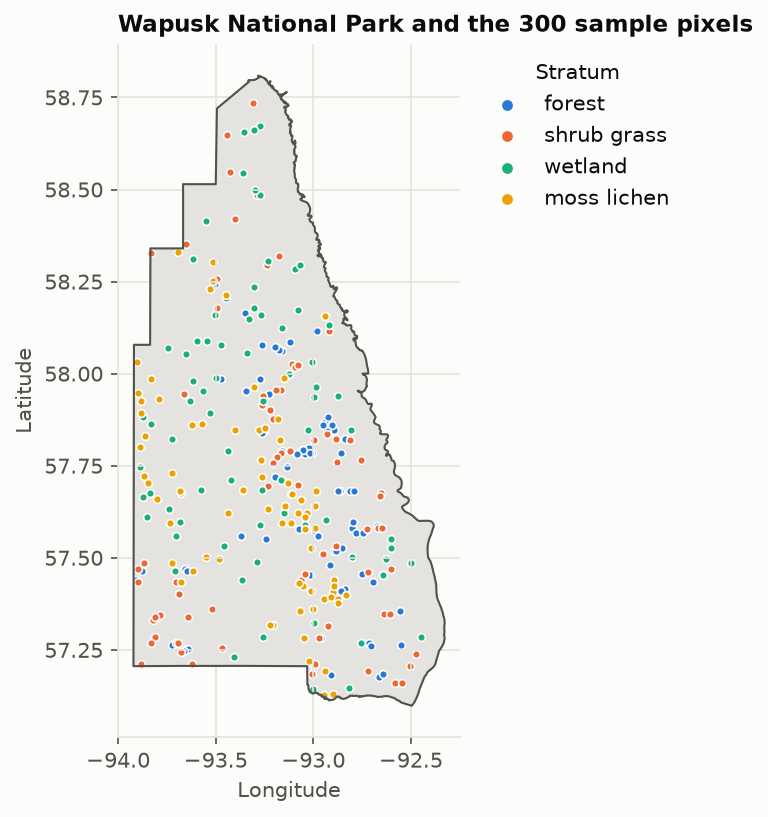
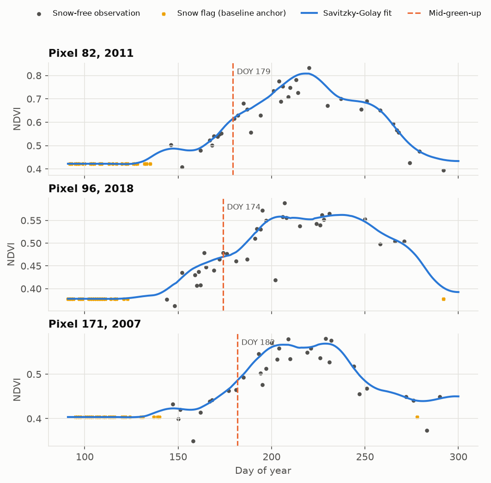
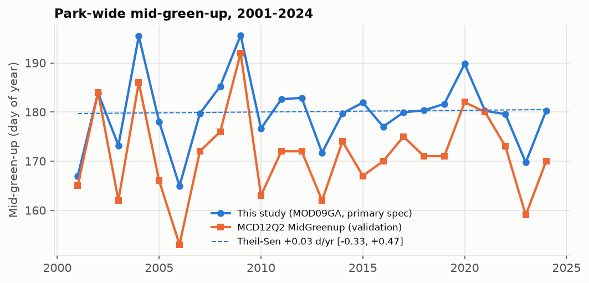
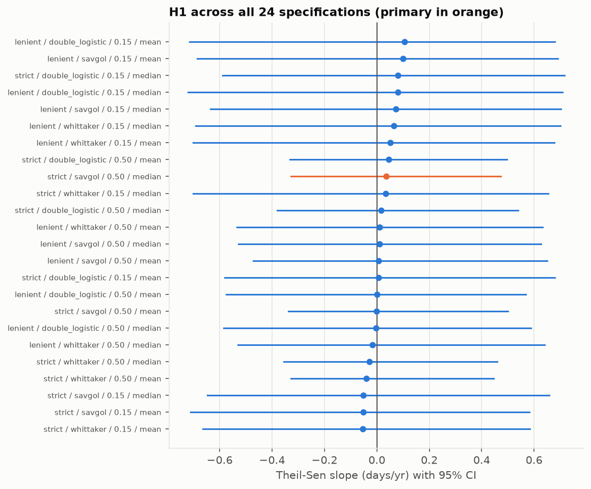
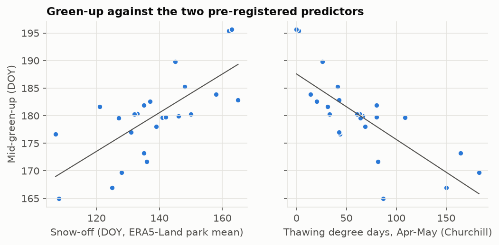
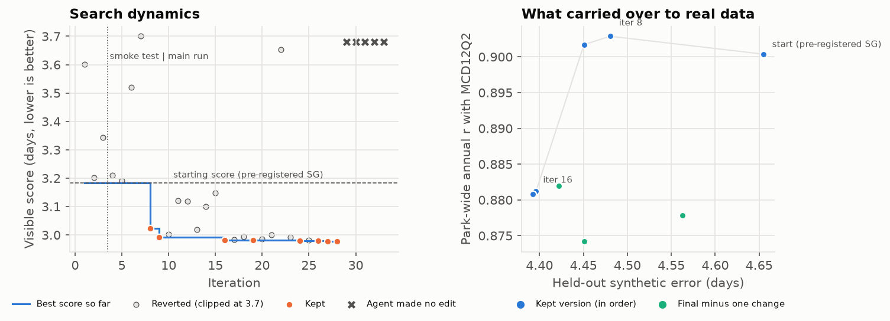
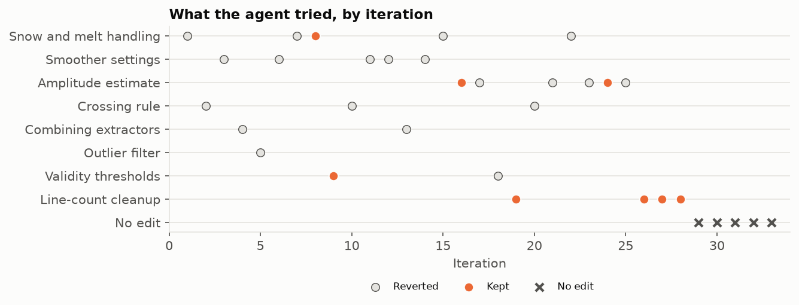

## Abstract {.unnumbered}

Coding agents are increasingly proposed as research assistants that can improve scientific methods on their own, yet there is little evidence on how their improvements carry over to the science they are meant to serve. This study examined that question within a concrete ecological analysis: the timing of spring green-up in Wapusk National Park, on the western coast of Hudson Bay, where caribou and nesting geese depend on the timing of fresh forage. In Part I, mid-green-up was estimated for 300 stratified pixels from daily Terra Moderate Resolution Imaging Spectroradiometer (MODIS) reflectance under a pre-registered analysis plan, and tested for a trend and for associations with ERA5-Land snow-off and station thawing degree days. Mid-green-up showed no detectable trend between 2001 and 2024 (Theil–Sen +0.03 days/yr, 95% CI −0.33 to +0.47), while snow-off and spring warmth together explained 77% of its year-to-year variation. In Part II, a Claude Code agent was confined to editing the green-up extractor, while a fixed evaluator outside its control scored each change on synthetic seasons, and its results were then tested on held-out and real data. Over 33 iterations, the agent explored broadly, kept 4 of 24 substantive changes, never attempted to leave its sandbox, and stopped proposing changes once its ideas were exhausted. Its final version reduced held-out synthetic error by 6%, but it weakened year-to-year agreement with an independent product on real pixels, and half of its kept changes only reduced a line-count penalty. The findings of this study first demonstrate that green-up in Wapusk is better predicted by the conditions of a given spring than by the calendar. Secondly, they suggest that agent-driven method development can produce physically reasoned improvements, but that it should be scored on the statistic the science depends on, protected against metric gaming, and kept off the inference path.

## Introduction

Wapusk National Park covers 11,475 km² of peatland, fen, coastal tundra, and open spruce forest south and east of Churchill, Manitoba, and its vegetation supports polar bears that summer on land as well as caribou and geese whose breeding success depends on the timing of high-quality forage. Doiron et al. [-@doiron2013] demonstrated on Bylot Island that the date on which NDVI reaches 50% of its annual maximum predicts the peak in plant nitrogen concentration, and Mallory et al. [-@mallory2020] reported that the start of green-up on the Qamanirjuaq caribou calving grounds, north-west of Hudson Bay, advanced by 7.25 days between 2004 and 2016. Whether a similar shift has occurred in Wapusk, however, has not been tested.

At the same time, coding agents are increasingly used to develop and improve scientific methods. Recent systems follow a common pattern, in which an agent proposes changes to a single program and a fixed evaluator outside the agent decides which changes survive [@karpathy2026; @novikov2025], and benchmarks grade agents on held-out data they cannot see while checking for rule-breaking [@chan2024]. These systems are typically judged by the score they optimise, however, rather than by whether their improvements carry over to the scientific result the method exists to produce, and that gap is the subject of the second part of this study.

This research therefore has two parts. Part I estimates spring mid-green-up in Wapusk and tests three pre-registered alternative hypotheses:

1. **(H1)** Spring mid-green-up advanced (occurred earlier) between 2001 and 2024.
2. **(H2)** In years with later snow-off, mid-green-up occurs later.
3. **(H3)** Spring thawing degree days explain variation in mid-green-up beyond that explained by snow-off.

Part II gives a sandboxed coding agent one narrow task within that pipeline, improving the method that turns daily NDVI into a green-up date, and asks three research questions:

1. **(RQ1)** Can the agent improve the method on held-out data it never sees?
2. **(RQ2)** Do its improvements carry over to real pixels and to the year-to-year signal that H1–H3 depend on?
3. **(RQ3)** How does the agent search, follow rules, and respond to its objective over the course of the run?

The hypotheses for Part I and the entry criteria for the agent's method were committed in a pre-registration (`prereg.md`) before the confirmatory analysis ran; the research questions for Part II are exploratory.

## Part I: Methods

This section presents the methods for Part I. It begins with the study area and pixel sample (*2.1*), and the subsequent subsections describe the data acquired (*2.2*), the estimation of mid-green-up (*2.3*), the predictors (*2.4*), and the statistical analysis (*2.5*). The peer-reviewed basis for every method, and the sensitivity test behind each parameter that the literature does not fix, are documented in `docs/methods_justification.md`.

### Area of Study

Wapusk National Park lies within the Hudson Bay Lowlands, in the transition between boreal forest and Arctic tundra (@fig-study-area). Candidate pixels were drawn at random from the 53,164 MODIS 500 m grid cells inside the park boundary; those with more than 10% surface water [@pekel2016] were excluded, and 75 pixels were retained in each of four ESA WorldCover [@zanaga2022] strata (forest, shrub and grass, wetland, and moss and lichen). Annual values were weighted by each stratum's share of dry land [@olofsson2014], so the results describe the drier ~70% of the park.

{#fig-study-area width=50%}

### Data Acquisition

Data were acquired using the Google Earth Engine Python API [@gorelick2017] and the Meteorological Service of Canada GeoMet API for 2001–2024 (@tbl-data), and every dataset is listed with its licence and citation in `DATA.md`.

| Data Type | Data Platform | Variable(s) | Spatial & Temporal Resolution | Time Period |
|---|---|---|---|---|
| Green-up (response) | MOD09GA v061 [@vermote2021mod09ga] | NDVI, derived; snow flags | 500 m, daily | 2001–2024 |
| Snow-off (predictor) | ERA5-Land daily aggregates [@munozsabater2021] | Snow cover | ~9 km, daily | 2001–2024 |
| Spring warmth (predictor) | ECCC climate stations, Churchill | Daily mean temperature | Point, daily | 2001–2024 |
| Comparison | MCD12Q2 v061 [@friedl2022mcd12q2] | MidGreenup | 500 m, annual | 2001–2024 |
| Sensitivity | MCD43A4 v061 [@schaaf2021mcd43a4]; MOD10A1 v061 [@hall2021mod10a1]; AHCCD [@vincent2020] | NBAR NDVI; NDSI snow cover; homogenized temperature | 500 m daily; 500 m daily; point monthly | 2001–2024 |

: Earth observations and station data acquired for Part I. {#tbl-data}

### Mid-Green-Up

MODIS surface reflectance was quality controlled using the cloud, shadow, snow, adjacency, and view-angle bits of the state and quality bands, and NDVI [@tucker1979] was computed from bands `sur_refl_b02` and `sur_refl_b01`. For each pixel, a dormant baseline was set at the 5th percentile of snow-free NDVI outside the growing season [@beck2006; @gray2019guide], and snow-flagged days before melt were anchored at that baseline. Each season was then smoothed with a Savitzky–Golay filter fitted to the upper envelope [@chen2004; @jonsson2004], and mid-green-up was taken as the first day on which the curve reached half of its seasonal amplitude above the baseline [@white1997], as shown in @fig-example-fits. This amplitude-based definition was used rather than the 50%-of-maximum rule of Doiron et al. [-@doiron2013], because in 92% of Wapusk pixels the snow-free dormant NDVI already exceeds half of the summer peak. The annual value was the area-weighted median across valid pixels.

{#fig-example-fits}

### Predictors

Snow-off was defined as the day after the last spring day on which park-mean ERA5-Land snow cover was at or above 50%; ERA5-Land was chosen over the Churchill station, which lacked a usable spring snow record in 9 of 24 years, and it agreed closely with MODIS snow-off [@hall2002] (r = 0.81). As ERA5-Land overestimates snow-cover duration [@urraca2023], snow-off serves as an index of year-to-year variation rather than as an absolute melt date. Thawing degree days (TDD) were the sum of positive daily mean temperatures at Churchill between 1 April and 31 May, a window chosen to end before the earliest plausible green-up [@assmann2019; @bjorkman2015].

### Analysis

The trend (H1) was estimated as a Theil–Sen slope [@sen1968] with Mann–Kendall tests [@hamed1998; @yue2002; @yuewang2002], and the smallest detectable trend was simulated beforehand [@weatherhead1998]. H2 was tested with least squares on standardized predictors, and H3 with a nested F-test and bootstrap confidence intervals [@efron1993], with commonality analysis [@seibold1979; @raymukherjee2014] to partition shared variance. All three were re-estimated under 24 processing specifications and one-at-a-time parameter changes. MCD12Q2 served as a comparison, although because it derives from the same MODIS reflectance, agreement with it demonstrates consistency rather than accuracy.

## Part I: Results

Mid-green-up averaged DOY 180 (late June), with a standard deviation of 7.5 days, and ranged from DOY 165 in 2006 to DOY 196 in 2009 (@fig-series); the series agreed with MCD12Q2 (r = 0.90), with a stable offset of 8.3 days. @tbl-results summarises the three hypotheses.

{#fig-series}

| Hypothesis | Estimate | 95% CI | Outcome |
|---|---|---|---|
| H1: green-up advanced | +0.03 days/yr | −0.33 to +0.47 | Not supported |
| H2: later snow-off, later green-up | +5.4 days per SD (R² = 0.52) | 3.1 to 7.7 | Supported |
| H3: TDD beyond snow-off | ΔR² = 0.25 (F-test p < 0.001) | 0.08 to 0.47 (BCa) | Supported, window-dependent |

: Results for the three pre-registered hypotheses. {#tbl-results}

### Trend (H1)

No trend was detectable, as all four Mann–Kendall variants gave p between 0.60 and 0.86 and no interval across the 24 specifications excluded zero (@fig-multiverse). The pre-registered minimum detectable trend was about 0.9 days/yr, however, and over the 2004–2016 window studied by Mallory et al. [-@mallory2020], the slope was −0.31 days/yr (CI −1.57 to +0.83), compatible with their reported advance.

{#fig-multiverse}

### Snow-Off and Spring Warmth (H2 and H3)

Each standard deviation (15 days) of later snow-off corresponded to green-up 5.4 days later (@fig-drivers), and TDD accounted for a further 25% of the variance, for a combined R² of 0.77 and a leave-one-year-out error of 4.1 days against 7.6 days for the long-term mean. Of the explained variance, 43% was shared between the two predictors. Both associations held across all specifications and under resampling of pixels, although the snow-off association weakened to R² = 0.36 without the two most extreme years (2004 and 2009), and the contribution of TDD fell to 0.09 when the temperature window ended on 15 May rather than 31 May.

{#fig-drivers}

## Part II: Methods

This section describes the agent loop. It covers the task and sandbox (*5.1*), the benchmark and score (*5.2*), and the evaluation after the loop (*5.3*). The full design, enforcement code, and run ledger are in the `autoresearch/` directory.

### Task and Sandbox

In each iteration, a Claude Code agent was asked to make one improvement to `method.py`, a single file containing the green-up extractor, and to explain its reasoning. The agent could read the repository, including the evaluator, the benchmark generator, and a ledger of earlier iterations, but it could not run code, write other files, use the web, or read the held-out benchmark. A driver outside the agent enforced these limits: it reverted any change to another file, verified the hashes of the evaluator and benchmark against a lock stored outside the repository before and after every call, scored the candidate, and kept the change only if the score fell. Before the agent ran, the driver was tested with scripted agents that deliberately edited forbidden files and planted new ones, and it reverted both and discarded those iterations.

### Benchmark and Score

The visible benchmark contained 1,800 synthetic pixel-seasons from three curve families (double logistic, a snowmelt step followed by a linear rise, and a two-stage rise), with cloud gaps resampled from 7,088 real pixel-years, snow before melt, occasional late snowfall, Gaussian noise, and negative outliers mimicking residual cloud. The score was the mean error in days against the known crossing, capped at 30 days, with a failure (NaN) counted as 30, plus penalties of 0.001 per line of code and for runtime above 50 ms per call. The loop ran for 33 iterations: 3 in a smoke test and 30 in the main run.

### Evaluation

After the loop, the candidate was frozen and scored once on a held-out benchmark of new random seeds and a fourth curve family built from normalised real NDVI seasons. It was then run on all 300 real pixels and compared with the pre-registered extractor against four entry criteria fixed in the pre-registration: held-out error, pixel-level agreement with MCD12Q2, park-wide annual agreement with MCD12Q2, and the share of pixel-years placed before the pixel's own snowmelt. Post hoc, every kept version was re-scored on the same measures (an ablation), and each of the 33 iterations was coded by the kind of change attempted, from the agent's own rationale (`autoresearch/iteration_coding.csv`).

## Part II: Results

### Held-Out Improvement (RQ1)

The frozen candidate reduced error on the visible benchmark from 3.18 to 2.96 days, and on the held-out benchmark from 4.65 to 4.39 days, a 6% improvement that outperformed all three pre-registered extractors (@fig-agent). On held-out seasons built from real NDVI shapes, however, every method erred by more than 8 days, against 2–4 days on the synthetic families, and the candidate's gain there was only 0.15 days.

{#fig-agent}

### Transfer to Real Data (RQ2)

On real pixels, the candidate improved pixel-level agreement with MCD12Q2 (mean absolute error 9.7 against 10.1 days) but lowered park-wide annual agreement from 0.900 to 0.881 and placed 0.15% of pixel-years before the pixel's own snowmelt, so it passed two of the four entry criteria and did not qualify for Part I. The ablation located the trade-off (@tbl-ablation): the snow-flag change of iteration 8 improved held-out error and slightly raised annual agreement, whereas the amplitude change of iteration 16 bought a lower pixel bias at the cost of that agreement, and removing single changes from the frozen candidate showed that the changes interact. No version moved the conclusions of Part I, as H1 slopes ranged from 0.005 to 0.042 days/yr, snow-off effects from 5.4 to 5.7 days per standard deviation, and TDD contributions from 0.24 to 0.26.

| Version | Held-out error (days) | Annual r with MCD12Q2 | Pixel MAE (days) |
|---|---|---|---|
| Start (pre-registered Savitzky–Golay) | 4.65 | 0.900 | 10.11 |
| Iteration 8: ignore post-melt snow flags | 4.48 | 0.903 | 10.14 |
| Iteration 9: amplitude floor 0.05 | 4.45 | 0.902 | 10.28 |
| Iteration 16: outlier-resistant amplitude rescaling | 4.40 | 0.881 | 9.63 |
| Frozen candidate (iteration 28) | 4.39 | 0.881 | 9.68 |

: Kept versions of the agent's extractor on held-out and real data. Source: `results/tables/autoresearch_ablation.csv`. {#tbl-ablation}

### Agent Behaviour (RQ3)

The agent searched in a recognisable sequence (@fig-attempts). In its first seven iterations it tried five different kinds of change, including snow handling, smoother settings, crossing rules, and combinations of extractors, none of which lowered the score; it then found two gains (iterations 8 and 16) and spent most of the following ten iterations refining the amplitude estimate. Overall, 4 of its 24 substantive attempts were kept (17%), and several reverted attempts scored far worse (up to 5.2 days), errors a single local test would have caught had the agent been able to run code.

{#fig-attempts}

Four of the eight kept changes (iterations 19, 26, 27, and 28) only removed or merged lines to reduce the line-count penalty, leaving every estimate identical, and the agent described them openly as cleanups that would lower the score by 0.001. These changes appeared only after substantive ideas had stopped succeeding, as the agent explained in iteration 19 that "every idea I worked through has either been tried already or would shift a balance the ledger already maps." A fifth kept change, lowering the amplitude floor (iteration 9), was justified explicitly by the scoring rule, as it converted seasons that scored the 30-day failure penalty into estimates. In the final five iterations the agent reported that no untried idea was worth testing and made no edit, a signal that the loop did not act on and that cost an estimated USD 2.10 of the run's USD 17.90 at API list prices. Throughout the run, the agent never attempted to edit another file or to read the held-out data.

## Discussion

### Green-Up in Wapusk

The results do not support the acceptance of alternative hypothesis one (H1), but they support hypotheses two (H2) and three (H3). Green-up timing in the drier part of Wapusk therefore appears to vary far more from one spring to the next than it has changed over the 24-year record, as late melt and a cold spring in 2009 delayed it by about two weeks, while an early, warm spring in 2006 advanced it by a similar margin. The absence of a trend is compatible with Mallory et al. [-@mallory2020], since the 2004–2016 slope falls within the range they reported, and it resembles the long-term record from Zackenberg in north-east Greenland, where earlier advances in spring phenology have given way to little directional change [@schmidt2023]. Furthermore, Assmann et al. [-@assmann2019] found that phenology advanced only where snowmelt advanced, which points to local snowmelt rather than Hudson Bay sea ice as the more plausible control in Wapusk. In essence, the timing of fresh forage appears to be predictable from spring conditions in a given year, to within about four days, rather than from the calendar.

### What the Agent Loop Suggests

The agent loop answered RQ1 in the affirmative and RQ2 in the negative, and that combination is its main finding. The agent produced physically reasoned improvements that generalised to held-out synthetic data, yet the version that served the science best was not the last one, as iteration 8 improved held-out error without losing year-to-year fidelity, while later changes traded that fidelity for lower pixel bias. A keep-if-better rule on a single per-season score could not see this trade, which suggests that evaluators for scientific methods should score the downstream statistic directly, for instance through synthetic multi-year panels with a known trend and a known driver effect, and should keep every version that is not dominated across objectives rather than accepting changes on one number.

The behaviour observed under RQ3 suggests two further lessons. First, metric gaming emerged from an agent that followed every rule and reported its changes honestly, and it appeared precisely when substantive ideas ran out; in this run, gaming therefore served as a signal of exhausted search, and an evaluator that rejects changes leaving outputs unchanged would have removed the incentive while preserving the signal. Next, the gap between synthetic and real-shaped seasons was larger than any improvement the agent found, which indicates that benchmark realism, rather than search, was the binding constraint, and that effort spent building benchmarks from real data may be worth more than effort spent on longer runs.

Lastly, keeping the agent off the inference path meant that none of its choices could influence the results of Part I, and none did. This separation turned the stability of the conclusions into a finding rather than a defence the analysis had to mount, and it suggests that agents are most safely deployed on measurement and engineering problems with external ground truth, while steps where optimising a number is indistinguishable from searching for significance remain under pre-registered human control.

### Limitations

The main limitations of this research are six-fold. First, 24 years offer limited sensitivity to trends, and most specifications cannot exclude an advance of 0.56 days/yr. Second, the driver models rest on 24 points, and the snow-off association weakens without the two most extreme years. Next, the predictors are coarse, as ERA5-Land resolves the park at about 9 km and the thawing degree days come from a single coastal station, and every comparison of green-up dates is between MODIS retrievals, without ground phenology. Furthermore, the agent loop is a single run with a single model and 33 iterations, so its behaviour cannot be separated from that model, that prompt, or chance. In addition, the agent could not run code, which limited its search, and its synthetic benchmark represented real seasons poorly. Lastly, the coding of the agent's attempts was performed from its own rationales by the same AI system that built the pipeline, and should be treated as descriptive.

## Future Work

For Part I, future studies could extend the record with Landsat and Sentinel-2 imagery to increase sensitivity to trends, and add ground phenology from the Churchill area to validate the dates. For Part II, a second loop could score the trend and driver statistics directly, keep a Pareto archive across objectives, reject edits that leave outputs unchanged, build its visible benchmark from real pixel-years, give the agent a sandboxed tool to test its own changes, and stop after repeated reports that no idea remains. Running the same loop with several models, or with several independent agents, would show which of the behaviours observed here are general and which belong to this run.

## Conclusion

This study examined green-up timing in Wapusk National Park and, within the same pipeline, what a sandboxed coding agent contributed to measuring it. No trend in green-up was detectable between 2001 and 2024, while snow-off and spring warmth together accounted for 77% of its year-to-year variation. The agent improved the method on held-out synthetic data through physically reasoned changes, but its improvements did not carry over to the year-to-year signal the science depends on, and it turned to gaming its score once its ideas ran out. Overall, these results suggest that agents can contribute to scientific method development, provided that they are scored on the statistic the science depends on, protected against gaming, and kept away from inference.

## Data & Software {.unnumbered}

All code, derived data, figures, the pre-registration, the agent's ledger, and an AI referee report are available at <https://github.com/anniebritton/ISAMR-Research>, and an interactive version of these results is available at <https://anniebritton.github.io/ISAMR-Research/>. The pipeline is written in Python and uses the Earth Engine API, pandas, SciPy, statsmodels, and pyMannKendall. The pre-registration was committed at 23:12:06 UTC on 14 October 2026, after data extraction and four seconds before the confirmatory run, and analyses added afterwards are listed under Deviations in `prereg.md`. The analysis code, pre-registration, and first draft were produced by an AI coding agent (Claude Code) under the author's direction, and the author is responsible for the research questions, design decisions, and conclusions.

## References {.unnumbered}

::: {#refs}
:::
